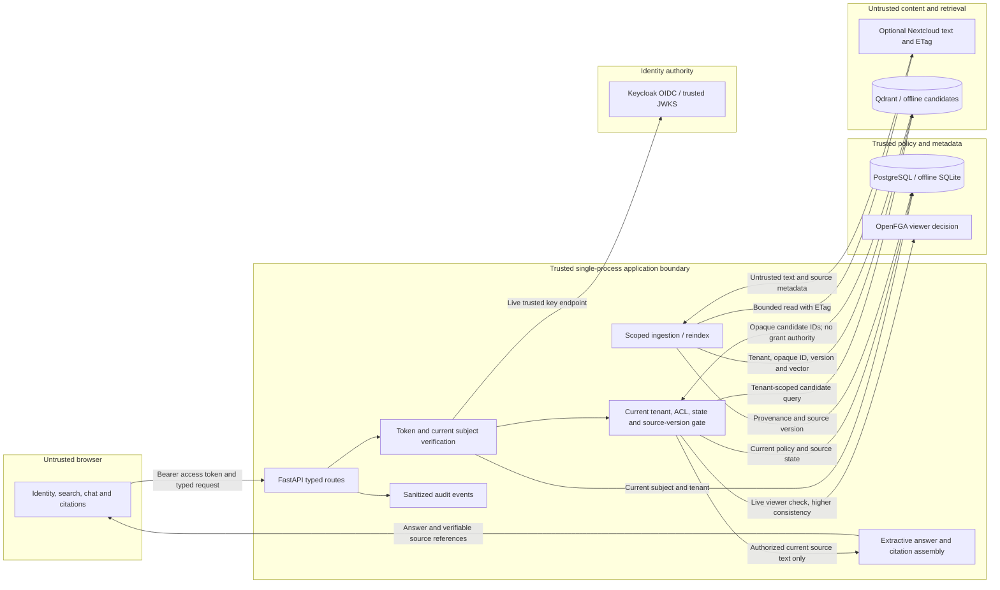

# Data flow and threat model

P-091 contains two execution paths. Offline mode uses local synthetic identity, SQLite metadata and deterministic retrieval for reproducible tests. Live mode substitutes Keycloak, PostgreSQL, OpenFGA and Qdrant; optional Nextcloud supplies text. Both paths must converge at the same trusted read gate. A service's presence in this diagram describes intended topology, not proof that it ran; consult `../evidence/` and the execution reports for observations.

There is no enabled provider or telemetry-export edge in the default architecture. A future model adapter would consume authorized context and return untrusted output; citations and all output would require the same server-side gate. Adding Langfuse would create a new data-export boundary and requires a tested redaction policy. Neither addition inherits assurance from deterministic tests.

## Assets, adversary and policy

Protect tenant-private content and titles, current memberships and grants, source identity/version, conversation-derived content, tokens, workload credentials and audit correlation. The modeled attacker is a low-privilege synthetic user who controls requests and may control text/metadata in an authorized source. Tests can additionally emulate a compromised retriever returning forged candidates. The adversary does not control server configuration, SQL, Keycloak signing keys, OpenFGA policy or the host. Administrative compromise is a separate residual risk.

Application ACL state is the policy source of truth in this laboratory. Effective access combines current tenant membership, tenant administrator status or explicit document/group grants, nondeleted state, known ACL state and current indexed/source version. Live mode additionally requires OpenFGA to permit the same originating human subject. Current application group policy is materialized into direct-user viewer tuples, with additions and removals reconciled; this is not proof of a complete source-system relationship graph. A token's groups or a vector's label cannot grant access. The indexer has its own actor type and scope; its broad connector visibility is not delegated to an end user.

## Trust boundaries and abuse hypotheses

| Boundary | Attacker-controlled input | Hypothesis / business impact | Required control and test |
| --- | --- | --- | --- |
| Browser → API | Bearer bytes, IDs, query, body fields | Forged identity or tenant; cross-tenant disclosure | Signature/issuer/audience/time checks; reject client identity overrides; negative token suite |
| Human → workload | Actor claims and endpoint choice | Employee writes index or indexer reads human data | Signed actor type plus current user type and route scopes |
| Tenant → tenant | Guessed document/history IDs | Contoso information reaches Northwind | Trusted tenant comparison before any content or title leaves API |
| Application → OpenFGA | Viewer request and relationship state | Unavailable/stale policy silently permits reads | Fail closed on errors; pinned model and higher-consistency live checks |
| Connector → application | Source text, ETag and permission metadata | Stale or modified source content reused | Bounded text read, provenance, version equality and unknown-state denial |
| Nextcloud ACL → app ACL | External shares and group changes | Unsupported source revocation appears synchronized | Explicitly incomplete; application-mediated policy only; no source-ACL fidelity claim |
| Application → retriever | Candidate rank, IDs, labels | Foreign or forged result bypasses ACL | Resolve trusted DB record and reauthorize every candidate |
| Retrieved text → answer | Instruction-like text and metadata | Unauthorized disclosure or misleading output | Treat as inert source data; deterministic quotes, current-access citation checks |
| Current policy → history/cache | Previously allowed source IDs | Revoked content survives in answers/exports | Reauthorize every underlying source and regenerate; no trusted cached answer |
| App → evidence/logs | Sensitive request contents and errors | Secrets or other-tenant metadata enter audit views | Allowlisted audit fields, generic errors, scoped dashboard, sanitized evidence |

These are threat hypotheses until an evidence record establishes an outcome. A tested malicious text fixture demonstrates one exercised path only; it cannot establish broad resistance to indirect injection in a real LLM.

## Change propagation and uncertainty

Application-mediated unshare, group removal and deletion must affect the next read decision, including old conversation views. Source edits make old versions unsuitable for citations; reindex refreshes retrievable content. Unknown ACL or sync state must deny content until repair. Content-only reindex cannot clear the independent unknown-ACL gate, and routine bootstrap must preserve existing administrator revocations. This is a fail-closed policy rather than an eventual-consistency grace period that silently grants access.

Nextcloud WebDAV access metadata describes the connector account's rights. It does not enumerate a complete authoritative human permission graph, and this implementation must not treat it as one. External Nextcloud share/unshare and group changes require a future reconciliation or online user-specific source check before they can satisfy the full source-permission requirement. SQL/OpenFGA coordination and read/write serialization in one API process do not prove distributed atomic revocation across replicas. These limits must remain visible in final acceptance gates.
